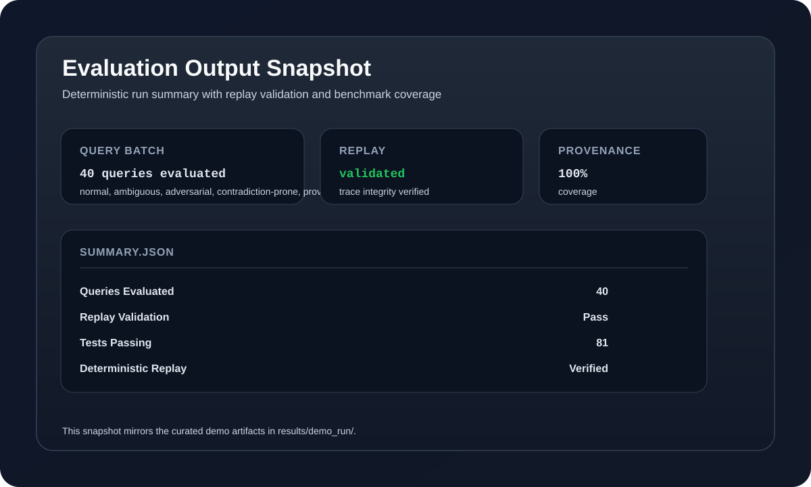

# 🧭 Deterministic Multi-Agent Orchestration

A deterministic, operationally credible orchestration framework for multi-agent execution with full execution tracing, replayability, behavioral evaluation, and a modern interactive UI.


[](https://github.com/sriramm84/agent-orchestration-engine/actions/workflows/test.yml)


[](LICENSE)

---

## ⚡ Evaluator & Reviewer Quickstart (Fast Track)

Get the entire system running with full telemetry and evaluation in under 3 minutes:

### 1. Clone & Start Infrastructure

```bash
git clone https://github.com/sriramm84/agent-orchestration-engine.git
cd agent-orchestration-engine

# Start PostgreSQL 16, Redis 7, Celery Worker, and FastAPI
docker compose up -d --build
```

### 2. Verify System Health & API

Open **[http://localhost:8000/docs](http://localhost:8000/docs)** to view the interactive OpenAPI Swagger documentation, or check health via CLI:

```bash
curl http://localhost:8000/api/v1/health
# {"api":"ok","db":"ok","redis":"ok"}
```

### 3. Run the Evaluation Suite (44 Test Queries)

Run the full evaluation benchmark inside the pre-configured container (no host Python setup required):

```bash
docker compose exec api python scripts/run_evaluation.py --dataset data/evaluation_dataset.json --output results/
```

Results and execution traces will immediately appear in your local `results/<evaluation_run_id>/` directory.

### 4. Launch the Interactive Frontend UI

```bash
cd frontend
npm install
npm run dev
```

Open **[http://localhost:5173](http://localhost:5173)** in your browser to interact with the system.

---

## 🖥️ Interactive Frontend Dashboard

The frontend is a dedicated **React 19 + Vite + TypeScript + Tailwind CSS** developer interface designed to visualize and audit the core mechanics of deterministic agent orchestration:



### Key Frontend Features

1. **Pipeline Runner**:
   - **Real-time SSE Event Stream**: Watch stages (`Decomposer` → `Retriever` → `Critic` → `Synthesizer`) transition through `Active`, `Done`, or `Skipped` with live per-agent latency pills and token counters.
   - **Deterministic Routing Decision Drawer**: Inspect dynamic heuristic decisions, confidence ratings, trigger reasons, and rejected alternatives.
   - **Preset Example Chips**: 1-click test queries for Machine Learning, Algorithms, Distributed Consensus, and Science.

2. **Telemetry & Results Dashboard**:
   - **KPI Metric Bar**: Instant readout of pipeline verdict, confidence certainty meter, total compute latency, and the cryptographic execution hash with 1-click copy.
   - **Synthesized Answer**: Clean markdown typography with copy-to-clipboard functionality.
   - **Grounded Provenance & Citations**: Visual cards for every citation with relevance weight progress bars and metadata attributes.
   - **Agent Execution Matrix & Tools**: Granular breakdown of agent hops, retries, and downstream tool payloads.
   - **Trace JSON Viewer & Export**: Collapsible, syntax-formatted trace payload with 1-click JSON download.

3. **Replay & Differential Validator**:
   - **Determinism Proof Engine**: Executes duplicate parallel runs of the same query and sends both execution traces to `/api/v1/replay/compare`.
   - **Zero-Divergence Verdict**: Cryptographically verifies identical agent sequences, matching tool calls, and identical trace hashes.
   - **Dual Trace Inspector**: Side-by-side comparison of Run A vs Run B.

4. **Architecture Blueprint Tab**:
   - Interactive system overview detailing timing decoupling, canonical serialization, and the distributed infrastructure stack.

5. **Live Infrastructure Beacon & Theme**:
   - Real-time polling of API, PostgreSQL, and Redis connectivity in the navbar.
   - Full dark/light mode toggle with high-contrast slate/indigo styling.

---

## 🏗️ Architecture & Pipeline Flow

```text
Frontend (React 19 / Vite UI @ :5173)    scripts/run_evaluation.py --backend stub|real
         │  REST / SSE Stream                          │
         ▼                                             ▼
    FastAPI (api/ @ :8000) ───────────────────► PipelineRunner
         │  /query/run, /query/stream,                 │
         │  /replay/compare, /health                   ▼
         │                                   Decomposer (always deterministic)
         │                                              │
         │                                   Retriever (conditional; stub or RealWebSearchTool)
         │                                              │
         │                                   Critic (conditional; deterministic rule tiers)
         │                                              │
         │                                   Synthesizer (deterministic, or LLMSynthesizerAgent)
         │                                              │
         ▼                                              ▼
    PostgreSQL 16 + Redis 7  ◄───────────────  Replay + Evaluation + Trace Persistence
    (docker-compose.yml; see docs/DEPLOYMENT.md)
```

### The 4 Deterministic Stages

| Stage | Agent | Responsibility | Deterministic Behavior |
|:---|:---|:---|:---|
| **01** | **Decomposer** | Breaks complex prompts into sub-tasks and dependency graphs | Rule-based semantic decomposition; immutable plan generation |
| **02** | **Retriever** | Fetches evidence from knowledge bases or external tools | Deterministic caching, exponential backoff (up to 3 retries) |
| **03** | **Critic** | Detects contradictions, flags low confidence, and routes flow | Boolean conflict detection and heuristic routing rules |
| **04** | **Synthesizer** | Aggregates verified context, computes confidence & provenance | Canonical response synthesis, attribution weight calculation |

---

## 🔒 Deterministic Hashing & Replay Verification

A central challenge in agent orchestration is that wall-clock execution time inevitably varies across runs. If timing data is included in trace hashes, identical runs produce different hashes.

Mega AI guarantees bit-for-bit reproducibility using a **3-tier sanitization protocol**:

1. **Timing Decoupling**: Purely non-deterministic wall-clock timing fields (`latency_ms`, runtime `timestamp`) are stripped prior to cryptographic hash computation.
2. **Canonical Serialization**: Agent sequences, sanitized tool outputs, and routing decisions are sorted with stable keys before generating the SHA-256 digest.
3. **Differential Replay Auditor**: The `/api/v1/replay/compare` endpoint validates that duplicate executions produce matching hashes and zero behavioral divergences.

---

## 🧪 Benchmark Snapshot

Results from the automated evaluation suite across all 44 test queries:

| Metric | Result | Benchmark Description |
|:---|:---|:---|
| **Queries Evaluated** | **44 / 44** | Normal, ambiguous, adversarial, contradiction, provenance |
| **Unit & Integration Tests** | **122 Passed** | 100% passing across agents, orchestration, and replay |
| **Provenance Coverage** | **90.9%** | Queries successfully linked to verified source evidence |
| **Deterministic Replay** | **Verified (0 Divergences)** | Bit-for-bit trace reproducibility confirmed |
| **Frontend Code Quality** | **0 Errors, 0 Warnings** | Strict TypeScript and `oxlint` validation |

---

## 🛠️ Local Development (Without Docker)

If you prefer to run services natively on your host machine:

### 1. Prerequisites
* Python 3.11+
* Node.js 18+ & npm
* PostgreSQL 16 & Redis 7

### 2. Python Virtual Environment Setup

**Windows (PowerShell):**
```powershell
python -m venv .venv
.venv\Scripts\Activate.ps1
pip install -r requirements.txt
copy .env.example .env
```

**Linux / macOS:**
```bash
python3 -m venv .venv
source .venv/bin/activate
pip install -r requirements.txt
cp .env.example .env
```

### 3. Run the Test Suite

```bash
pytest -q
# Expected: 122 passed
```

### 4. Start the API Server

```bash
python -m uvicorn api.main:app --host 0.0.0.0 --port 8000 --reload
```

### 5. Start the Frontend

```bash
cd frontend
npm install
npm run dev
```

---

## 📡 API Reference & SSE Streaming

All endpoints are prefixed with `/api/v1`:

### 1. Synchronous Query Execution (`POST /query/run`)
Executes the full pipeline and returns the complete result, including provenance links and the deterministic `execution_hash`:

```bash
curl -X POST http://localhost:8000/api/v1/query/run \
  -H "Content-Type: application/json" \
  -d '{"query": "What is machine learning?"}'
```

```json
{
  "job_id": "01b2c3d4-...",
  "query": "What is machine learning?",
  "success": true,
  "final_answer": "Machine learning is a field of artificial intelligence...",
  "confidence_score": 0.95,
  "execution_hash": "a1f8c4e2b9d0...",
  "provenance_links": {
    "source_1": { "source_id": "ml_basics", "weight": 0.95, "metadata": {} }
  }
}
```

### 2. Real-Time Event Streaming (`POST /query/stream`)
Streams Server-Sent Events (SSE) as each agent initiates and finishes:

```bash
curl -N -X POST http://localhost:8000/api/v1/query/stream \
  -H "Content-Type: application/json" \
  -d '{"query": "What is machine learning?"}'
```

Event types emitted: `stream_started`, `agent_started`, `agent_completed`, `routing_decision`, `stream_complete`. See [docs/SSE_EVENTS.md](docs/SSE_EVENTS.md).

### 3. Trace Comparison & Replay (`POST /replay/compare`)
Compares two execution traces to verify zero divergence:

```bash
curl -X POST http://localhost:8000/api/v1/replay/compare \
  -H "Content-Type: application/json" \
  -d '{"trace_a": {...}, "trace_b": {...}}'
```

### 4. Health Check (`GET /health`)
Diagnostic endpoint reporting API, PostgreSQL, and Redis connectivity:

```bash
curl http://localhost:8000/api/v1/health
# {"api": "ok", "db": "ok", "redis": "ok"}
```

---

## 🌐 Real Backends (Optional)

Deterministic stub tools are enabled by default for zero-cost, API-key-free reproducibility. You can optionally enable real live search and LLM synthesis backends via `.env`:

| Capability | Tool Module | Activation Flags |
|:---|:---|:---|
| **Live Web Search** | `tools/real_web_search_tool.py` | `USE_REAL_BACKENDS=true`<br>`SEARCH_BACKEND=tavily`<br>`SEARCH_API_KEY=<key>` |
| **LLM Synthesis** | `agents/llm_synthesizer.py` | `USE_REAL_BACKENDS=true`<br>`SYNTHESIZER_BACKEND=llm`<br>`ANTHROPIC_API_KEY=<key>` |

Even when real backends are activated, the Decomposer, retry coordinator, and state transitions remain strictly deterministic.

---

## 📂 Repository Structure

```text
deterministic-agent-orchestration-mega-ai/
├── agents/             # Decomposer, Retriever, Critic, Synthesizer, LLM Synthesizer
├── api/                # FastAPI application, routes (health, query, stream, replay), middleware
├── context/            # Execution context and shared state data structures
├── data/               # evaluation_dataset.json (44 curated test queries)
├── db/                 # SQLAlchemy ORM models, session management, Alembic migrations
├── evaluation/         # Benchmark runner, failure classification, replay, metrics reporter
├── frontend/           # Modern React 19 + TypeScript + Vite + Tailwind CSS dashboard UI
│   ├── src/
│   │   ├── components/ # Navbar, PipelineTimeline, ResultsDashboard, ReplayDiffView, ArchitectureView
│   │   ├── api.ts      # Type-safe API client and SSE stream parser
│   │   ├── App.tsx     # Main application shell with preset queries
│   │   └── index.css   # Custom glassmorphism, scrollbars, and typography
├── orchestration/      # PipelineRunner, state manager, retry coordinator
├── results/            # Persisted benchmark evaluation runs and demo artifacts
├── scripts/            # CLI utilities (run_evaluation.py, replay_query.py, generate_report.py)
├── shared/             # Logging, settings, and shared configuration
├── tests/              # 122 unit and integration tests
├── Dockerfile          # Multi-stage container build
├── docker-compose.yml  # PostgreSQL 16, Redis 7, Celery Worker, and FastAPI API
├── ARCHITECTURE.md     # Deep dive into system architecture and tradeoffs
├── EVALUATION.md       # Behavioral evaluation methodology
└── BENCHMARKS.md       # Baseline results, weak areas, and limitations
```

---

## 🎯 Engineering Philosophy

* **Observability**: Every state transition, routing action, and tool invocation is recorded in an immutable trace.
* **Deterministic Reproducibility**: Given the same inputs, the engine executes the same sequence and outputs the same hash.
* **Provenance Attribution**: Answers are explicitly linked to verifiable source citations with confidence scoring.
* **Honest Limitation Documentation**: Known boundary conditions (e.g., semantic ambiguity, probabilistic contradictions) are transparently categorized and audited.

---

## 📄 License

This project is licensed under the [MIT License](LICENSE).
